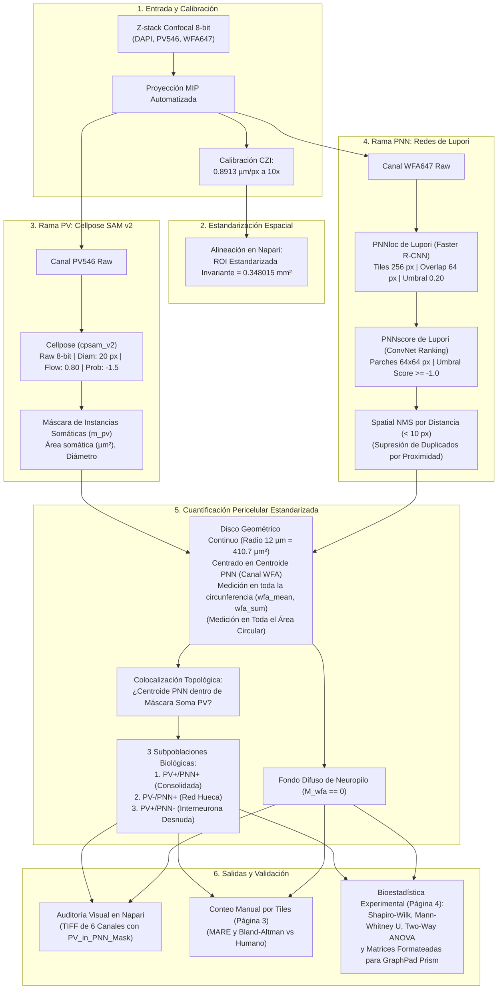

# Metodología de Análisis de Redes Perineuronales (PNNs) e Interneuronas PV+ en Corteza Somatosensorial (S1)

## Procedimiento Experimental y Comparativa: Lupori et al. (2023) vs. Pipeline del Estudio Actual

**Autores:** Daniel Zangrando & Rodrigo Yarzábal  
**Laboratorio:** Laboratorio de Neurobiología / HistoLab  
**Región de Estudio:** Corteza Somatosensorial Primaria (S1 / SSC)  
**Marco de Aplicación:** Defensa de Tesis / Presentación Metodológica  
**Estado:** Metodología y Parámetros Validados  

---

## 1. Introducción y Marco de la Presentación

Este documento describe el procedimiento experimental y bioinformático implementado para la adquisición, segmentación y cuantificación de **Redes Perineuronales (PNNs)** mediante marcación con *Wisteria floribunda agglutinin* (WFA) y su colocalización con **Interneuronas Parvalbúmina-positivas (PV+)** en la corteza somatosensorial primaria (S1).

Para la instancia de defensa de tesis:
- **Rodrigo Yarzábal** presentará el trabajo de **Lupori et al. (*Cell Reports*, 2023)** como el marco de referencia publicado del cual se adoptaron los modelos convolucionales de detección de PNNs (`PNNloc` y `PNNscore`).
- **Daniel Zangrando** expondrá las decisiones metodológicas adoptadas en el estudio actual: la segmentación morfométrica de somas con Cellpose SAM, la cuantificación por disco geométrico continuo estandarizado para comparar sin sesgos las subpoblaciones PV+ y PV-, y la normalización espacial constante en S1.

---

## 2. Medición de Intensidad: Parche con Random Forest (Lupori) vs. Disco Continuo Estandarizado

Una diferencia metodológica central radica en **cómo se delimita la PNN para cuantificar su señal de fluorescencia**:

### A. ¿Cómo midió Lupori et al. (2023)? *(Parche local y clasificación de píxeles)*
1. Lupori et al. centraron un parche cuadrado de 80 × 80 píxeles sobre la coordenada detectada de cada célula.
2. Sobre ese parche aplicaron un clasificador de píxeles basado en **Random Forest** (*TreeBagger* en MATLAB) entrenado con **16 filtros de Gabor** (4 frecuencias espaciales × 4 orientaciones).
3. Este clasificador etiquetaba cada píxel individual como *foreground* (célula/red) o *background* (fondo).
4. La intensidad celular se definió como el promedio de los píxeles etiquetados como *foreground*.

### B. ¿Cómo se realizó en este estudio? *(Disco Circular Continuo Estandarizado)*
1. Se estableció un **disco geométrico circular continuo** (`draw.disk`) de radio fijo *R*pnn = **12.0 µm** (13.46 px a 0.8913 µm/px), delimitando un área constante de **410.71 µm²** centrada en el centroide de la PNN (canal WFA).
2. **Medición integral:** Se cuantifica la intensidad integrada (`wfa_sum`) y la intensidad media (`wfa_mean`) en la totalidad del disco circular en su rango dinámico nativo de 8 bits (0 - 255), sin aplicar binarizaciones de Otsu artificiales que censuren intensidades intermedias.
3. **Fundamento biológico y comparabilidad libre de sesgos (PV+ vs. PV-):**
   - En la corteza somatosensorial, entre el 15% y el 40% de las PNNs envuelven neuronas que **no expresan parvalbúmina detectable** ("redes huecas" / PV-).
   - Si la medición dependiera del contorno de una célula o de una máscara morfológica previa de PV, las PNNs que envuelven células PV- no tendrían referencia somática, por lo que quedarían excluidas del análisis o se medirían con un criterio geométrico completamente diferente al de las redes PV+.
   - Al trazar un disco circular invariante centrado en el centroide de la PNN en el canal WFA, **tanto las redes PV+ como las PV- se cuantifican exactamente bajo la misma superficie física (410.71 µm²)**, garantizando una comparación directa, reproducible y libre de sesgos metodológicos entre ambas subpoblaciones.

---

## 3. Parámetros Validados del Pipeline

A continuación se detallan los parámetros de adquisición, inferencia y cuantificación validados para el pipeline:

| Parámetro | Valor | Función Metodológica |
| :--- | :--- | :--- |
| **`pixel_size_um`** | **0.8913 µm/px** | Factor de escala confocal extraído automáticamente de los metadatos XML CZI (objetivo 10x). |
| **`intensity_depth`** | **8 bits (en contenedor TIFF 16-bit)** | Rango dinámico nativo (0 - 255) procesado sin reescalado ni saturación. |
| **`area_roi_corteza_mm2`** | **0.348015 mm²** | Superficie constante (661 × 661 px) para normalizar densidades (*N* / mm²) en columna cortical de S1. |
| **`pnn_radius_um`** | **12.0 µm** (13.46 px) | Radio del disco geométrico continuo de cuantificación perasomática de WFA. |
| **`pnn_disk_area`** | **410.71 µm²** | Superficie circular constante sobre la cual se calculan `wfa_mean` y `wfa_sum`. |
| **`pv_cellpose_model`** | **`cpsam_v2`** | Modelo híbrido U-Net + SAM ViT para segmentación somática de interneuronas PV. |
| **`pv_cellpose_diameter`** | **20.0 px** (≈ 17.83 µm) | Diámetro somático estimado para interneuronas PV en corteza S1. |
| **`pv_cellpose_flow_threshold`** | **0.80** | Tolerancia de gradiente para reconstruir somas multipolares o estrellados. |
| **`pv_cellpose_cellprob_threshold`** | **-1.50** | Umbral permisivo para captar somas débilmente fluorescentes sin omisión celular. |
| **`pv_cellpose_min_size`** | **15 px** (≈ 11.9 µm²) | Filtro mínimo para excluir ruido puntual o detritos fluorescentes. |
| **`PNNloc_model`** | **`pnn_v2_fasterrcnn_640`** | Faster R-CNN (ResNet-50 + FPN) de Lupori et al. evaluando mosaicos de 256 px con overlap de 64 px. |
| **`PNNloc_threshold`** | **0.20** | Umbral de confianza para propuestas de regiones con acumulación de WFA. |
| **`PNNscore_model`** | **`pnn_v2_scoring_rank_learning`** | ConvNet de ranking de Lupori et al. (5 bloques convolucionales) sobre parches de 64 × 64 px. |
| **`PNNscore_threshold`** | **-1.00** | Umbral permisivo de score: rescata redes tenues o intermedias sin censurar variabilidad biológica. |
| **`nms_distance_px`** | **10 px** (≈ 8.91 µm) | Spatial NMS: supresión no máxima euclidiana para eliminar duplicados generados por el solapamiento de tiles. |

---

## 4. Cuadro Comparativo Integral: Lupori et al. (2023) vs. Metodología Adoptada

| Dimensión | Paper Original: Lupori et al. (2023) | Metodología Adoptada (HistoLab) | Fundamento Metodológico |
| :--- | :--- | :--- | :--- |
| **Detección de PNNs** | Faster R-CNN (`PNNloc`) + ConvNet de Ranking (`PNNscore`) a escala fija. | **Mismas redes preentrenadas de Lupori et al.** (`PNNloc` + `PNNscore`), adaptadas en mosaicos de 256 px (overlap 64 px), umbral -1.00 y Spatial NMS (10 px). | Aprovecha el consenso multi-evaluador de Lupori pero elimina conteos redundantes en los bordes de tiles. |
| **Detección de PV+** | Detección puntual con Faster R-CNN (`PVloc`) + ranking (`PVscore`) arrojando una coordenada (X, Y) sin contorno celular. | **Segmentación de instancias somáticas con Cellpose (`cpsam_v2`)**. Genera contornos celulares somáticos reales. | Permite medir el **área somática real en µm²** y el diámetro de cada interneurona, permitiendo evaluar cambios morfométricos. |
| **Cuantificación de PNN** | Parche cuadrado de 80 × 80 px clasificado píxel a píxel mediante Random Forest y 16 filtros de Gabor. | **Disco circular continuo de radio 12.0 µm (410.71 µm²)** centrado en el centroide de la PNN (canal WFA). | Superficie estandarizada que permite comparar sin sesgo metodológico las subpoblaciones PV+ y PV-. |
| **Tratamiento de Señal** | Normalización regional dividida por media de todo el cerebro en CCFv3. | **Medición cruda de 8 bits (0 - 255) sin Otsu**. Se preserva la señal continua sin recortar mallas intermedias. | Máxima fidelidad cuantitativa en todo el rango dinámico del sensor confocal. |
| **Colocalización** | Distancia euclidiana entre centroides ≤ 15 px (9.675 µm). | **Inclusión topológica celular:** El centroide PNN cae dentro de la máscara somática de Cellpose (`m_pv[r, c] > 0`). | Comprueba contención física del soma dentro de la red, evitando falsos positivos por neuronas adyacentes. |
| **Subpoblaciones** | Dos porcentajes globales (% PV con PNN y % PNN con PV). | **Tres subpoblaciones biológicas:** 1. PV+/PNN+ (Consolidadas) 2. PV-/PNN+ (Redes huecas / no-PV) 3. PV+/PNN- (Interneuronas desnudas) | Permite analizar la plasticidad diferencial entre subtipos celulares de la corteza. |
| **Estandarización Espacial** | Deformación elástica de encéfalos completos al atlas 3D CCFv3 (QuickNII + VisuAlign). | **ROI Estandarizada Invariante de Columna Cortical (Área fija = 0.348015 mm²)** en Napari. | Invariante frente a deformaciones elásticas o variaciones angulares del corte histológico. |
| **Fondo Difuso** | Media regional dividida por la media cerebral global. | **Neuropilo difuso (*I*diffuse)** medido exclusivamente sobre parénquima libre de redes (*M*wfa == 0). | Cuantifica el pool soluble no ensamblado de proteoglicanos CSPG en el espacio intercelular. |

---

## 5. Diagrama de Flujo del Procedimiento

---

## 6. Guía para la Defensa de Tesis: Respuestas a Preguntas Clave

### P1: "¿Cuál es la diferencia entre cómo midió la intensidad Lupori et al. y cómo lo midieron ustedes?"
> **Respuesta:** "Lupori et al. aplicaron en cada parche de 80 × 80 px un clasificador de píxeles Random Forest con 16 filtros de Gabor para etiquetar píxeles individuales como célula o fondo, promediando únicamente los píxeles clasificados como célula.  
> Nosotros optamos por un **disco geométrico continuo de radio fijo 12.0 µm (410.71 µm²)** centrado en el centroide de la red detectada en el canal WFA, midiendo la intensidad integrada y media en toda la circunferencia. Esta decisión metodológica garantiza una **comparación libre de sesgos entre subpoblaciones PV+ y PV- (redes huecas)**: dado que las PNNs que rodean neuronas PV- no cuentan con una máscara somática previa, el disco continuo permite cuantificar ambos grupos exactamente bajo la misma superficie física y sin recurrir a filtros de umbralización inestables."

### P2: "¿Ustedes utilizaron las redes neuronales de Lupori para detectar PNNs?"
> **Respuesta:** "Sí. Para la localización de PNNs en el canal WFA empleamos las redes preentrenadas por Lupori et al. (`PNNloc` Faster R-CNN y `PNNscore` ConvNet de ranking). Adaptamos su inferencia dividiendo la imagen en mosaicos de 256 px con 64 px de solapamiento, establecimos un umbral permisivo de score en -1.00 para capturar la variabilidad de redes intermedias, e implementamos un algoritmo de supresión espacial no máxima por proximidad euclidiana (10 px) para evitar contar duplicados en los bordes de los tiles."

### P3: "¿Cómo hubiera detectado Lupori las células PV y por qué usaron Cellpose?"
> **Respuesta:** "Lupori et al. detectaban las células PV mediante una red Faster R-CNN (`PVloc`) y una de ranking (`PVscore`) que arrojaban una coordenada puntual (X, Y) sin contorno somático ni área.  
> Nosotros utilizamos **Cellpose** (`cpsam_v2`), que delinea mediante campos de flujo vectorial el contorno somático de cada interneurona. Esto nos permitió obtener el área somática real en µm² de cada célula (crucial para evaluar posibles cambios tróficos o hipertrofia somática) y definir la colocalización por inclusión topológica del centroide de la red dentro del perímetro celular real."

### P4: "¿Por qué utilizaron una ROI fija de 0.348 mm² en vez de registrar al atlas CCFv3?"
> **Respuesta:** "El registro elástico al atlas CCFv3 requiere cortes coronales de hemisferio completo con referencias macroscópicas globales. En microscopía confocal a 10x centrada en la corteza somatosensorial local, aplicar deformaciones elásticas distorsiona la escala física celular.  
> La ROI estandarizada de 0.348015 mm² delimita un marco translaminar constante en S1. Al mantener fija esta superficie en Napari en todas las muestras, cualquier variación en el conteo celular representa una diferencia biológica real de densidad, libre de artefactos de registro o retracción tisular."

---

## 7. Arquitectura Detallada de las Redes Neuronales Empleadas

### 7.1. Segmentación Somática de Interneuronas PV+: Cellpose (`cpsam_v2`)
* **Familia:** Modelo de Segmentación de Instancias Celulares (*Instance Segmentation*).
* **Backbone:** Arquitectura residual U-Net acoplada con un codificador visual basado en Transformers derivado de SAM (*Segment Anything Model*). Integra conexiones residuales densas (*skip connections*) para preservar detalles de alta frecuencia espacial en la membrana somática.
* **Representación del Espacio de Salida:**
  Cellpose predice simultáneamente **3 mapas continuos**:
  1. Campo de flujo horizontal $V_x(r, c) \in [-1, 1]$: Vector unitario apuntando hacia el centro topológico del soma.
  2. Campo de flujo vertical $V_y(r, c) \in [-1, 1]$: Vector unitario apuntando hacia el centro topológico del soma.
  3. Mapa logístico de probabilidad celular $P_{	ext{cell}}(r, c) \in [0, 1]$: Probabilidad de que el píxel pertenezca al citoplasma/soma.
* **Inferencia por Integración de Flujo (*Gradient Tracking*):**
  Durante la inferencia, cada píxel con $P_{	ext{cell}} > 	ext{cellprob\_threshold}$ (-1.50) se desplaza a lo largo del campo vectorial $(V_y, V_x)$ mediante integración numérica de Euler. Los píxeles que convergen en el mismo centroide se consolidan en una máscara de instancia individual etiquetada.
* **Parámetros Clave:**
  - `diameter`: 20.0 px (≈ 17.83 µm).
  - `flow_threshold`: 0.80.
  - `cellprob_threshold`: -1.50.
  - `min_size`: 15 px.

### 7.2. Detección Espacial de Redes Perineuronales: `PNNloc` (Lupori et al., 2023)
* **Familia:** Detector de Objetos de Dos Etapas (*Two-Stage Object Detector* - Faster R-CNN).
* **Backbone y Extracción Multiescala:**
  - Red residual profunda **ResNet-50**.
  - **Feature Pyramid Network (FPN):** Pirámide de características multiescala ($P_2, P_3, P_4, P_5, P_6$) que combina semántica profunda con resolución espacial fina.
* **Etapa 1 - Region Proposal Network (RPN):**
  Evalúa conjuntos de *anchors* con diferentes tamaños y relaciones de aspecto ($1:1$, $1:2$, $2:1$), generando candidatos de regiones con alta acumulación de WFA.
* **Etapa 2 - RoIAlign y Cabezales de Inferencia:**
  - **RoIAlign:** Muestreo bilineal continuo que preserva la resolución espacial submétrica.
  - **Cabezal de Clasificación y Bounding Box:** Red densa que emite probabilidad y coordenadas de la caja delimitadora.
* **Adaptación en Nuestro Pipeline:**
  - Inferencia por **mosaicos (*tiles*) de 256 px con 64 px de solapamiento**.
  - Umbral `lupori_loc_threshold = 0.20`.

### 7.3. Clasificación y Calificación de Redes: `PNNscore` (Lupori et al., 2023)
* **Familia:** Red Convolucional Profunda de Aprendizaje de Ranking (*Rank-Learning ConvNet*).
* **Entrada:** Recorte cuadrado estandarizado de **64 × 64 px** centrado en la coordenada $(X, Y)$ predicha por `PNNloc`.
* **Arquitectura:**
  - 5 bloques convolucionales consecutivos con filtros de $3	imes 3$, seguidos de *Batch Normalization*, activación ReLU y *Max Pooling* ($2	imes 2$).
  - Capa de *Global Average Pooling* que reduce el mapa de características a un vector de 512 dimensiones.
  - Capa densa lineal entrenada con *Margin Ranking Loss* basada en el acuerdo de **7 evaluadores expertos**.
* **Parámetros y NMS Espacial:**
  - `lupori_score_threshold = -1.00`: Umbral permisivo para captar redes intermedias.
  - **Spatial Non-Maximum Suppression (Spatial NMS):** Algoritmo euclidiano que suprime detecciones a menos de **10 px (≈ 8.91 µm)**, conservando el candidato de mayor score.

